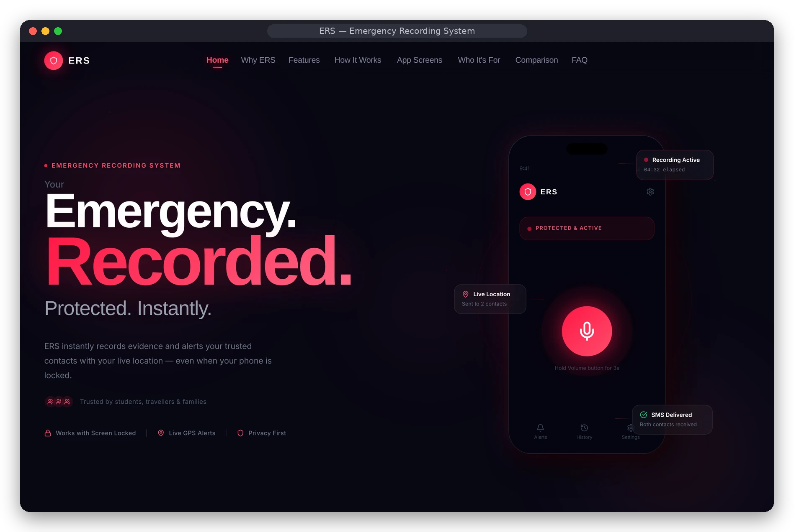
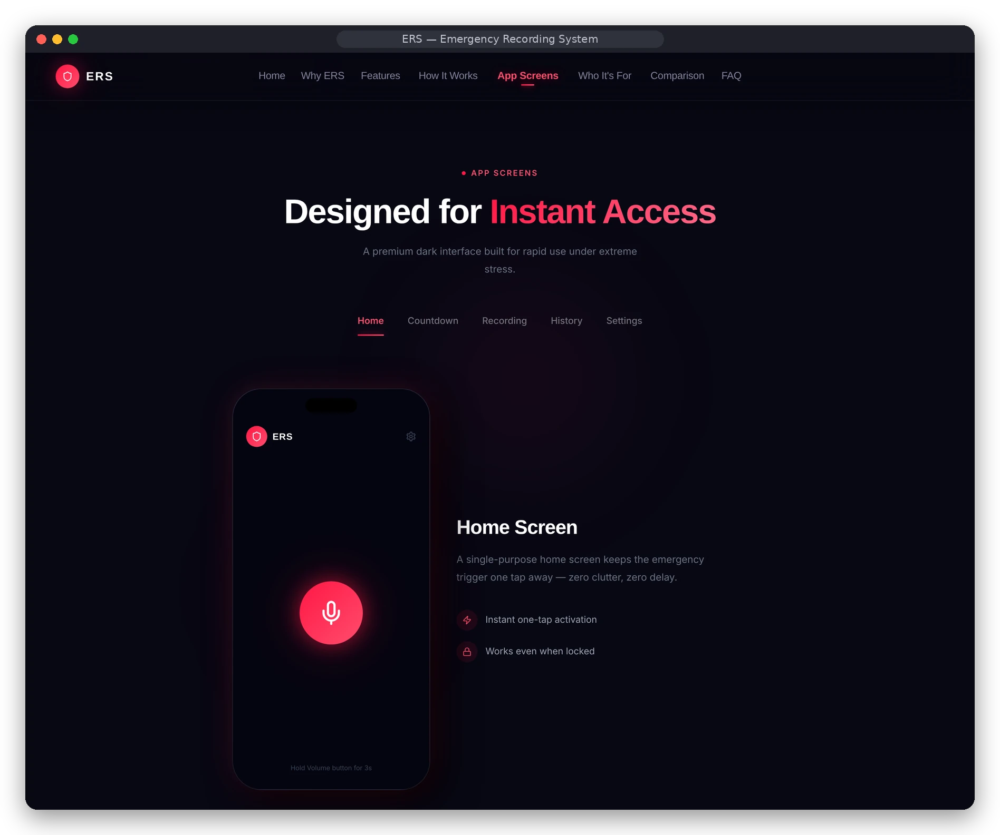
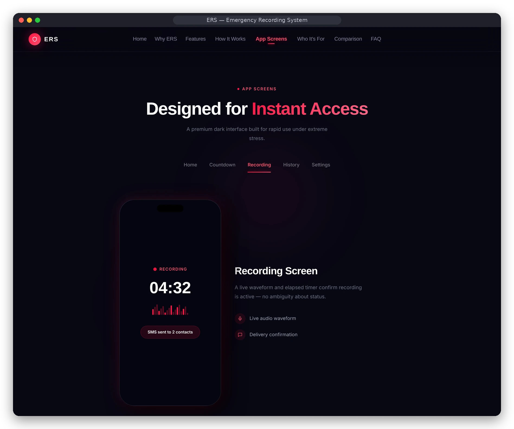

<div align="center">

# 🚨 ERS App — Emergency Recording System
### *A native Android app that records audio and alerts trusted contacts from a hardware-button trigger*

[](https://developer.android.com/)
[](https://www.java.com/)
[](https://gradle.org/)
[](https://github.com/kvalecha186-dot/ers-app/actions/workflows/android-ci.yml)

[Product Website](https://emergencyrecordingsystem.vercel.app) · [Preview](#-preview) · [Build the app](#open-and-build-the-android-app) · [Website Repo](https://github.com/kvalecha186-dot/emergencyrecordingsystem)

<br/>



</div>

---
ERS (Emergency Recording System) is an Android application I have been working on for situations where a person may need to start recording quickly and alert trusted contacts without going through the usual steps of unlocking the phone and opening an app.

The main idea is simple: set up the app in advance, add trusted emergency contacts, grant the required permissions and enable the emergency service. When the configured hardware-button trigger is used, ERS can start an audio-recording workflow and prepare or send emergency alerts using the configured communication methods.

This repository contains the Android Studio project files. The primary implementation is in the `ERS` project folder.

## 📸 Preview

<table>
  <tr>
    <td width="50%"><br/><sub><b>App screens</b> — home screen as shown on the product website</sub></td>
    <td width="50%"><br/><sub><b>Recording screen</b> — live timer and SMS delivery confirmation</sub></td>
  </tr>
</table>

> These images come from the [companion product website](https://github.com/kvalecha186-dot/emergencyrecordingsystem), which presents the app's screens as mockups. Screenshots taken directly on an Android device will be added here.

## Main features in the Android implementation

- **Onboarding and setup:** Guides the user through initial configuration and required permissions.
- **Hardware-button trigger:** Uses an Android Accessibility Service to detect configured volume-button interactions.
- **Emergency recording service:** Uses Android's `MediaRecorder` through a foreground service to capture audio.
- **Location support:** Uses Android location permissions and Google Play Services Location to obtain location information for alerts.
- **Trusted contacts:** Lets users configure emergency contact details.
- **Emergency alerts:** Includes SMS alert handling and email integration. WhatsApp sharing is also part of the alert workflow.
- **Recording history:** Provides a screen for reviewing recordings saved by the app.
- **Settings:** Includes trigger configuration, recording-duration options, permission status and optional backup settings.
- **Notifications and feedback:** Uses persistent notifications and vibration feedback to show service and recording status.

The exact behaviour depends on Android permissions, device settings, OS restrictions and whether the user has configured the relevant services correctly.

## How the trigger flow is intended to work

```text
Initial setup
    |
    v
Add trusted contacts + grant permissions
    |
    v
Enable ERS background service
    |
    v
Use the configured volume-button trigger
    |
    v
Safety countdown / trigger confirmation
    |
    v
Start audio recording
    |
    +----> Capture location for the alert
    |
    +----> Notify configured emergency contacts
    |
    v
Stop recording and save the audio file
    |
    v
Review or share the recording
```

The app is designed to reduce the number of steps needed during a stressful situation. It should still be configured and tested in advance; it is not a replacement for calling local emergency services.

## Tech stack

| Area | Technology |
|---|---|
| Platform | Android |
| Language | Java |
| IDE / build | Android Studio and Gradle |
| UI | AndroidX, Material Components and ConstraintLayout |
| Background work | Android Services and Foreground Services |
| Trigger detection | Android AccessibilityService |
| Audio | MediaRecorder |
| Location | Google Play Services Location |
| Alerts | SMS APIs, email integration and WhatsApp sharing intents |
| Local settings | SharedPreferences |

## Repository layout

The repository currently contains more than one Android Studio project under the uploaded project folder:

```text
ers app zip file manan/
└── ERSPROJECT/
    └── AndroidStudioProjects/
        ├── ERS/       # Main Android app implementation
        └── ERSUI/     # Separate UI project / interface work
```

For the main application, start with:

`ers app zip file manan/ERSPROJECT/AndroidStudioProjects/ERS`

The `ERSUI` project is separate from the main `ERS` implementation; it should not be mistaken for the complete recording-service implementation.

## Open and build the Android app

1. Clone this repository.
2. Open the `ERS` folder shown above in Android Studio.
3. Let Android Studio sync the Gradle project and download the required dependencies.
4. Connect an Android device or start an emulator.
5. Review the permission and service setup before testing.
6. Build and run the app from Android Studio.

On Windows, you can also build the debug APK from the project directory:

```bat
cd "ers app zip file manan\ERSPROJECT\AndroidStudioProjects\ERS"
gradlew.bat assembleDebug
```

On macOS or Linux:

```bash
cd "ers app zip file manan/ERSPROJECT/AndroidStudioProjects/ERS"
./gradlew assembleDebug
```

The debug APK is generated under the app module's Gradle build output directory.

## Permissions and user control

ERS uses sensitive Android capabilities because its purpose involves recording audio and sending emergency information. Depending on the Android version and features enabled, setup may request:

- Microphone access for audio recording.
- Location access for location-based alerts.
- SMS permission for SMS alerts.
- Notification permission for foreground-service status.
- Accessibility Service enablement for hardware-button detection.
- Battery-optimisation settings to improve background reliability.

These permissions should be explained clearly and granted only by the device owner. Users should be able to see whether the emergency service is enabled and should know how to turn it off.

## Important limitations

- Android background execution and Accessibility behaviour can vary between Android versions and device manufacturers.
- The app cannot guarantee that an emergency alert will be delivered. SMS, mobile network, GPS, battery and device restrictions can all affect delivery.
- WhatsApp sharing and other external-app flows depend on the installed app and Android sharing behaviour.
- Email delivery depends on valid email/SMTP configuration and network access.
- Automatic actions must respect Android security rules and user consent. A prepared share screen is not the same as a message being delivered.
- ERS should be tested on real devices with the screen on and off before relying on it.

This is a development project, not a certified emergency-response service. It should not be relied on as the only safety measure or as a substitute for contacting local emergency services.

## Related project

The companion website introduces ERS and explains the product:

[Emergency Recording System website](https://github.com/kvalecha186-dot/Emergencyrecordingsystem)

## Current development focus

- Test the volume-button trigger across supported Android versions and devices.
- Verify microphone, location, SMS and notification permission flows.
- Test recording start/stop behaviour and recovery from interruptions.
- Verify alert delivery and failure handling for each configured channel.
- Review sensitive permissions, privacy messaging and secure handling of email configuration.
- Keep the website's feature descriptions aligned with what the Android app actually does.

## Why I built it

I wanted to explore how Android features such as background services, accessibility events, audio recording, location and notifications can work together in a practical safety-focused application. ERS has been a useful project for learning about Android permissions, device behaviour and the difference between a feature that looks good in a demo and one that needs to work reliably on a real phone.


## Security implementation

- The Gmail SMTP App Password is encrypted with AES-GCM using a non-exportable Android Keystore key before it is written to app preferences.
- Existing installations migrate a previously stored plaintext SMTP password to the encrypted format on the next settings read/save. If the Android Keystore key is invalidated, the app will require the user to enter the App Password again.
- Trusted contact details and recordings remain on-device unless the user explicitly shares or backs them up.
- Never commit SMTP App Passwords, signing keys, service-account credentials or real emergency contact data to this repository.

## Automated build

The repository includes a GitHub Actions workflow that assembles the main Android app's debug APK. The APK is published as a workflow artifact after a successful build. CI compilation does not replace real-device testing of Accessibility triggers, foreground recording, SMS delivery, email delivery, location permissions or Android background restrictions.


## Release and safety status

> **Prototype notice:** ERS is an emergency-assistance prototype, not a certified or guaranteed emergency response service. Do not rely on it as the only way to contact emergency services. Device manufacturers, Android versions, carrier rules, battery policies and permission settings can prevent background triggers or SMS/email/location delivery. Always keep an independent emergency contact method available and validate the app on each supported device before real-world use.

The CI artifact is a **debug APK for testing**, not a Play Store release. A production release still requires a privately managed signing keystore, a signed release build, a privacy/data-safety review, and end-to-end device/carrier tests. Never commit the signing keystore or its passwords to GitHub.
